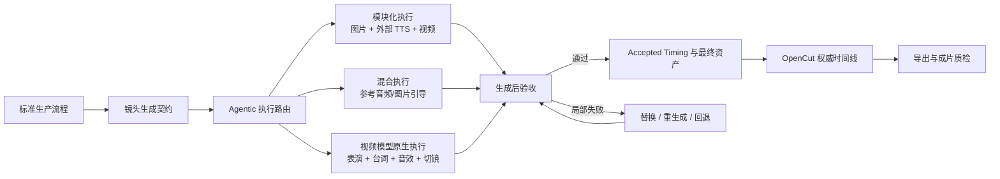

# 视频模型原生能力与稳定生产流程的共存策略

> 状态：产品与技术决策草案  
> 适用范围：漫剧生产平台 MVP 及后续视频模型接入  
> 核心议题：当视频模型具备更强的演绎、台词、音效、配乐、运镜和内部切镜能力时，如何在释放模型能力的同时保留工业化生产的稳定性。

## 1. 核心结论

平台不应在“严格模块化流水线”和“端到端视频模型”之间二选一，而应将二者拆成两个层次：

- **标准生产流程是控制平面**：负责剧本结构、镜头预算、身份一致性、场景连续性、时间规划、素材权威与验收标准。
- **各类生成模型是执行平面**：根据镜头特点和 Provider 能力，选择由独立 TTS、图片模型、视频模型或混合方案完成实际渲染。

因此，剧本、参考配音、分镜图等流程产物不一定都必须进入最终成片。它们也可以作为计划基线、模型输入、表演参考或失败回退资产。

平台长期的核心能力不是“比底层模型更会生成”，而是：

1. 判断哪些约束必须锁定、哪些创意应该释放；
2. 为每个镜头选择合适的生成粒度和执行方式；
3. 验证模型输出是否满足项目事实与连续性要求；
4. 在失败时只修复受影响的局部，而不是整片重新抽卡。

## 2. 为什么不能持续堆叠 Prompt

视频模型越强，过长上下文、互相冲突的提示词和过细的控制项越可能压缩模型的有效创作空间，造成：

- 表演僵硬；
- 运镜机械；
- 镜头内部缺乏自然调度；
- 模型注意力被无关角色、场景或资产稀释；
- 为满足大量局部要求而牺牲整体画面质量。

正确方向不是把整个项目 Bible 和全部素材塞入每次请求，而是为当前镜头编译一份**最小充分生成契约**：只携带必须保持的事实、当前镜头相关素材、时间边界和创作意图。

同时，将部分控制从“生成前写死”转移到“生成后验证和局部修复”。

## 3. 总体架构



标准流程始终存在，但其产物需要明确角色，而不能默认全部成为最终成片素材。

### 3.1 资产角色

建议所有生成资产显式标记用途：

- `planning_reference`：用于规划、估时或构图，不直接发布；
- `generation_input`：作为下游模型的受控输入；
- `performance_guide`：表达情绪、停顿和表演意图；
- `final_candidate`：等待人工或自动质检的最终候选；
- `accepted_master`：已被采用、可进入权威时间线的成片素材；
- `fallback_asset`：原生方案失败时可安全回退的资产。

这样可以避免把“参考配音”误认为“最终配音”，也能避免把占位分镜图误认为必须逐帧复刻的最终画面。

## 4. 镜头生成契约

每个镜头进入执行层之前，应固化一份可审计的生成契约。契约至少包含：

### 4.1 身份与连续性

- 角色身份及其当前服装、发型、年龄感和标志性细节；
- 当前镜头涉及的关键道具及状态；
- 场景、时间、天气、光线和空间连续性；
- 与上一镜、下一镜需要保持的进入/退出状态；
- 禁止新增、删除或改变的对象。

### 4.2 时间与叙事

- 目标时长；
- 可接受时长区间；
- 台词、旁白和关键动作的时间窗口；
- 前后剪辑余量；
- 是否允许模型内部切镜；
- 是否允许后期裁切、补尾或轻量时间调整。

### 4.3 创作自由度

- 表情和肢体表演：锁定、引导或自由；
- 运镜：锁定、引导或自由；
- 镜头内部调度：锁定、引导或自由；
- 台词演绎：外部音频、参考引导或模型原生；
- 环境音、动作音、BGM：分别指定来源策略。

### 4.4 Provider 绑定

- Provider、模型和不可变配置 revision；
- Provider 支持的图片、视频、音频参考能力；
- 是否支持音色参考、精确台词、音轨分离和内部切镜；
- 本次采用的执行策略与回退策略。

契约的目标不是将所有内容都写进 Prompt，而是形成一个权威事实源。Prompt 编译器只选择当前 Provider 和当前镜头真正需要的部分。

## 5. 约束分层

### 5.1 硬约束：必须满足

- 角色身份、服装和标志性细节；
- 关键道具的外观、位置和归属；
- 场景身份和基础空间关系；
- 台词原文不能被随意改写；
- 镜头时长必须处于批准区间；
- 不得出现非预期角色、肢体、物体变形或画面闪变；
- 不得破坏相邻镜头已经锁定的连续性事实。

### 5.2 软约束：优先满足

- 表演情绪；
- 构图倾向；
- 景别和镜头运动方向；
- 光影与氛围；
- 动作节奏；
- 环境声设计。

### 5.3 创作空间：默认交给模型

- 微表情；
- 自然停顿和呼吸；
- 细小肢体动作；
- 镜头内部次要调度；
- 不影响连续性的光影变化；
- 对主题有帮助但不改变事实的视觉细节。

## 6. 音频策略：参考音频与最终音频分离

### 6.1 三类音频

#### Timing Proxy

- 使用低成本 TTS 或本地估时器生成；
- 用于估算台词和旁白占用时长；
- 决定拆镜方式、镜头预算和初始时间线；
- 不要求达到最终情绪质量；
- 默认不进入最终成片。

#### Performance Guide

- 包含情绪、重音、停顿、语速和角色表演意图；
- 可由更高质量、更具情绪表现力的 TTS 生成；
- 在 Provider 支持时作为视频模型音频参考；
- 可以进入最终成片，也可以只作为表演引导。

#### Final Master

- 最终采用的视频模型原生音频或高质量外部 TTS；
- 必须通过台词、音色、情绪、时长和音质验证；
- 字幕和最终时间线以它的实测结果为准。

### 6.2 时间权威的演进

参考配音只能提供时间预算，不能永久成为最终时间权威。每个镜头应经历：

```text
plannedTiming → generatedTiming → acceptedTiming
```

- `plannedTiming`：来自文本、Timing Proxy 和导演规划；
- `generatedTiming`：来自模型实际输出；
- `acceptedTiming`：通过验收或人工调整后，真正进入 OpenCut 的时间权威。

例如：

```text
目标时长：5.4 秒
允许范围：4.8–6.2 秒
台词关键落点：1.1 秒、3.7 秒
剪辑余量：首尾各 8 帧
```

只要原生演绎处于批准区间且关键语义落点合理，就不应强行压回廉价占位音频的精确时长。

### 6.3 原生台词的采用门槛

视频模型原生台词至少需要通过：

- ASR 对稿，检测漏词、错词和改写；
- 说话人识别，确认角色归属；
- Speaker embedding 或等价声纹检测，验证跨镜音色一致性；
- 语速、停顿和情绪检测；
- 时长区间与关键时间窗口检查；
- 字幕重新对齐。

不通过时，允许：

1. 只重生成当前镜头；
2. 回退至外部高质量 TTS；
3. 在具备安全条件时替换对白并重新对齐；
4. 重新拆镜，而不是截断台词或破坏表演。

## 7. BGM、环境音与动作音

逐镜采用模型原生 BGM 容易造成旋律、节拍、调性和响度不连续，因此默认策略应为：

- 视频模型可以生成环境音和动作音；
- BGM 默认在集级由 OpenCut 统一铺设；
- 只有整段连续生成，或 Provider 能提供可验证的独立音轨时，才优先采用模型原生 BGM；
- 如果原生输出无法分离对白、音乐与环境声，应明确降低其可编辑性评分，而不是假装可以无损后期处理。

## 8. 三种生产策略

平台应提供少量高层策略，而不是让用户面对几十个底层开关。

### 8.1 稳定优先

- 外部高质量 TTS 作为最终音频；
- 逐镜生成；
- 强角色、场景和关键道具参考；
- 视频模型不生成最终对白和 BGM；
- OpenCut 完成剪辑、混音和字幕。

适合角色一致性要求高、长对话、商业交付和模型能力尚未完成验收的场景。

### 8.2 平衡模式（建议默认）

- 始终生成 Timing Proxy；
- 角色、场景和关键道具保持硬约束；
- 表情、肢体表演和镜头内部调度交给视频模型；
- 可逐镜采用视频模型原生台词；
- BGM 默认后期统一完成；
- 原生结果必须经过自动质检和人工确认。

### 8.3 模型原生优先

- 参考音频主要用于时间和表演引导；
- 视频模型可以接管台词、音效、运镜和内部切镜；
- 系统主要负责身份约束、结果验证、时间线固化和失败回退；
- 仍然保留 OpenCut 权威时间线，不让 Provider 临时结果成为不可恢复的唯一事实源。

## 9. Agentic 路由，而不是配置爆炸

系统应根据镜头和 Provider 能力自动推荐执行策略，并由用户确认。推荐维度包括：

- 角色数量及身份敏感度；
- 关键道具数量；
- 动作复杂度；
- 台词长度和情绪强度；
- 是否需要精确口型；
- 场景是否连续；
- Provider 是否支持音频参考、音色参考、分轨和内部切镜；
- 当前项目对成本、稳定性和表现力的优先级。

示例建议：

```text
本镜为短促高情绪独白，角色单一、场景固定。
建议：平衡模式；保留角色/场景硬约束，允许模型原生台词，
生成后执行 ASR 对稿与声纹一致性检查。
```

Agent 只能产生建议，不能在用户未确认时自动触发付费媒体任务。

## 10. 自适应生成粒度

平台不应永远固定“一镜一生成”，也不应默认将完整 45 秒全部交给模型。建议根据风险动态决定粒度：

- **单镜生成**：身份敏感、关键道具复杂、动作风险高或精确台词要求高；
- **连续多镜生成**：同场景、同角色、低风险连续对话，允许模型发挥自然切镜和表演；
- **整段生成**：Provider 已通过对应能力验收，且该段落能提供可靠身份、音频和时间控制；
- **拆回标准时间线**：即使由模型生成多镜连续片段，最终仍应识别镜头边界并固化到 OpenCut 时间线，保留剪辑、替换和回退能力。

系统可以把稳定性风险看成一个分数：风险越高，生成粒度越细、硬约束越强；风险越低，交给模型的上下文和创作空间越大。

## 11. 生成后验收与局部修复

稳定性不能只依靠 Prompt，必须有独立验收层。

### 11.1 视觉验收

- 人脸、发型、服装和角色身份一致性；
- 关键道具的存在性、外观和归属；
- 场景与相邻镜头连续性；
- 首尾关键状态；
- 肢体、物体和空间结构异常；
- 闪变、融化、重复肢体和明显 AI 伪影。

### 11.2 音频验收

- 台词文本准确性；
- 说话人和音色一致性；
- 情绪、语速和响度；
- 音乐、对白和环境音的可编辑性；
- 音频与画面动作、口型和镜头边界的匹配。

### 11.3 时间线验收

- 实测时长是否处于批准区间；
- 台词和字幕是否越过镜头边界；
- 是否存在不可解释的空隙或重叠；
- 是否需要补尾、裁切、重排或重新拆镜；
- 最终 OpenCut revision 是否与采用的资产和验收报告绑定。

验收不通过时，修复范围应精确到镜头、音轨或元素，不能默认重建整集。

## 12. 数据与审计要求

每次执行和采用决策都应固化：

- 镜头生成契约 revision；
- Provider、模型与配置 revision；
- 输入资产 ID、版本和 checksum；
- Prompt 编译版本；
- 计划、生成和采用三类 timing；
- 自动质检结果；
- 用户采用、回退或重生成决策；
- 最终 OpenCut timeline revision。

切换 Provider 或执行模式不能覆盖旧资产。每次重新生成都应产生新版本，并保留完整谱系。

## 13. MVP 建议顺序

### 第一阶段：先完成抽象，不扩大 Provider 范围

1. 为音频增加 `timing_proxy`、`performance_guide`、`final_master` 角色；
2. 将 timing 拆成 `planned`、`generated`、`accepted`；
3. 为镜头增加 `audioPolicy`、`cameraAutonomy`、`editAutonomy` 和 `generationGranularity`；
4. 保持当前逐镜图片、逐镜视频和 OpenCut 流程可用；
5. 将“最终是否采用原生音频”变成人工确认动作。

### 第二阶段：引入平衡模式

1. 接入更具情绪表现力的 TTS，作为 Performance Guide 或 Final Master；
2. 对支持原生音频的视频 Provider 开放逐镜原生台词；
3. 增加 ASR 对稿、声纹一致性和字幕重新对齐；
4. 不通过时回退至外部 TTS；
5. BGM 继续由 OpenCut 集级统一处理。

### 第三阶段：自适应粒度与 Agentic 路由

1. 建立 Provider capability matrix；
2. 由 Agent 推荐稳定优先、平衡或模型原生优先；
3. 支持连续 2–3 镜作为一个模型请求；
4. 自动识别并拆回 OpenCut 镜头边界；
5. 用实际通过率、返工次数和单个可用镜头成本持续调整路由策略。

## 14. 验收指标

不能只以“任务成功”或“可以播放”作为完成标准。建议跟踪：

- 角色一致性通过率；
- 关键道具一致性通过率；
- 场景连续性通过率；
- 原生台词逐字准确率；
- 跨镜说话人一致性；
- 音画边界误差；
- 单镜首次可用率；
- 每个最终采用镜头的平均生成次数；
- 局部修复率与整段重生成率；
- 原生音频采用率及回退原因；
- 人工审核耗时；
- 单分钟可交付成片成本。

## 15. 默认产品决策

在视频模型的原生台词、跨镜音色和分轨能力尚未通过项目级验收前，推荐默认采用：

1. 角色、场景和关键道具始终作为硬约束；
2. 始终生成低成本 Timing Proxy，用于拆镜和预算；
3. 视频模型默认负责视觉表演、环境音和动作音；
4. 最终对白默认使用具备稳定音色和高情绪表现力的外部 TTS；
5. 允许逐镜试用模型原生台词，通过 ASR、声纹和时长检查后再采用；
6. BGM 默认由 OpenCut 在集级统一完成；
7. 所有最终资产必须进入不可变 OpenCut 时间线并保留回退谱系。

随着模型能力增强，平台可以逐步扩大模型原生执行范围，但不需要推翻标准流程。标准流程从“所有环节都必须亲自生成最终资产”升级为“为任意执行模型提供稳定、可验证、可恢复的生产控制系统”。

